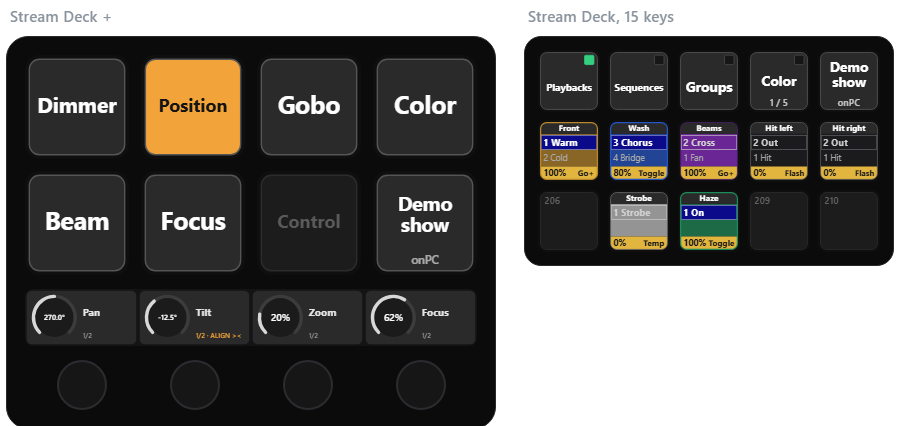
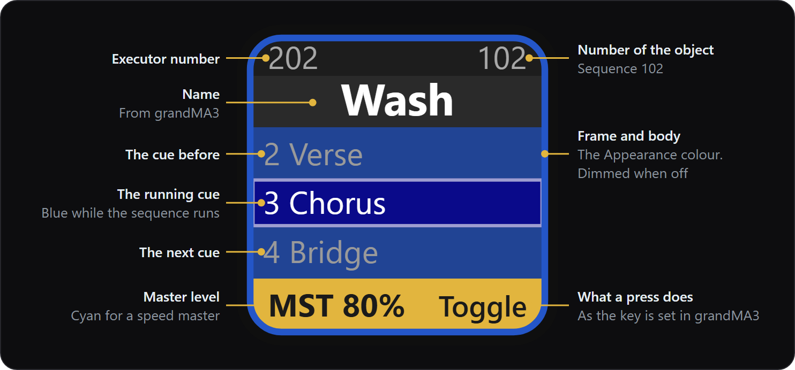
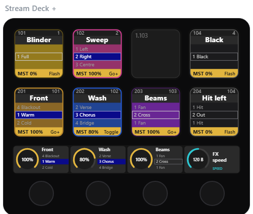
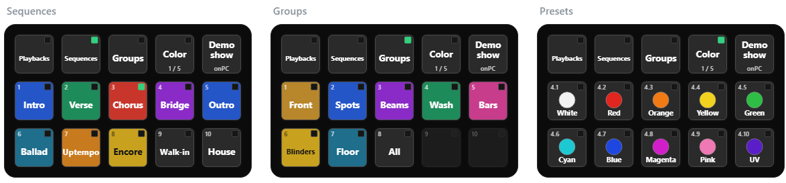
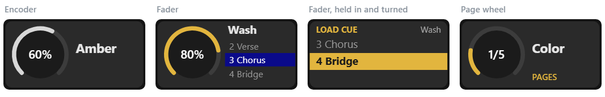
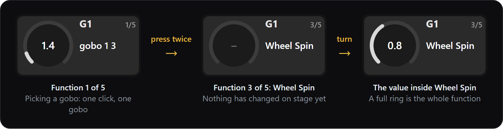
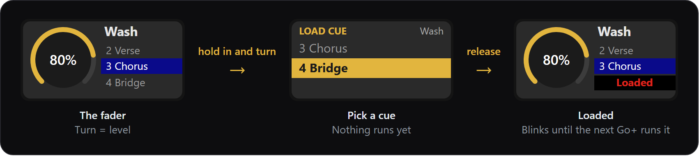

  

  <b>grandMA3 on your Stream Deck — and it shows your show.</b> 
  Executors, cue lists, groups, presets, faders and programmer encoders, with their names, colours and state read live from grandMA3. 
  It connects by itself: <b>no OSC, no IP addresses.</b>

  

---

## What it is

CueDeck turns an Elgato **Stream Deck** into a control surface for **grandMA3**. A small plugin runs *inside* grandMA3
and announces itself on the network; the Stream Deck side finds it — whether grandMA3 is on the same computer, another
computer, or a console.

The keys are not shortcuts with fixed labels. Each one asks grandMA3 what is there *right now* — the name, the
Appearance colour, the running cue, the fader level — and draws it. Rename a group in the show and the key follows.
Load another show and the same layout fills itself with that show.

CueDeck is a set of building blocks for **your own workflow**: drag the actions onto your keys and dials the way you
work. Five starter profiles, one per Stream Deck model, are included to begin from.

## What you get depends on your Stream Deck

Not every model can show or do everything on this page. The keys differ in size, and only the Stream Deck + has dials
and a touch strip.

| | Stream Deck + | XL, Neo | 15 keys, Module 15, Mini |
| --- | --- | --- | --- |
| Key size | 120 px | 96 px | 72–80 px |
| Executor key | Full: numbers, name, previous, current and next cue, level, function | As on the + | Simplified, with larger text: name, current and next cue, level, function |
| Other keys | Normal text | Normal text | Larger text |
| Dials and touch strip: Encoder, Fader with cue list and hold-to-load, Cue Picker, Parameter Wheel, Page Wheel | Yes | No | No |
| Starter profile included | CueDeck Plus | CueDeck XL, CueDeck Neo | CueDeck 15, CueDeck Mini |

- On a deck without dials, the dial actions can still be placed on a key, with less to them: a Fader key switches the
  level off and back, a Cue Picker key sends Go+, a Page Wheel key becomes a mode key, an Encoder key only shows the value.
- The text size follows the model by itself. It can be forced to normal or large for all decks in the settings of the
  **Connection** key.
- CueDeck is developed on Windows, on a Stream Deck + and a Stream Deck Module 15. The other models, and macOS, run
  the same code but have not been tried.

## What it looks like

### Playbacks, drawn as grandMA3 draws them

An executor on a key shows what the playback window shows. Pressing it does whatever that key is set to in grandMA3
(Go+, Flash, Toggle, Temp …). Small keys get a simplified drawing with larger text.

  

  

### One page, many pools

A row of **mode keys** picks what the keys below show: playbacks, sequences, groups, presets. Nothing is typed in per
key — a line such as `Groups = Group 1` says where to start, and the keys count on from there.

  

### Dials that know what they hold

On a Stream Deck +, every dial draws its own tile on the touch strip.

  

- **Encoder** — a programmer encoder. Left empty it follows the feature group selected in grandMA3. Hold and turn to
  fine-adjust; press for the attribute's next function, as in the list beside each encoder in grandMA3:

  

- **Fader** — an executor's master, a speed master, a group master. When the executor holds a sequence, its cues are
  listed beside the knob. **Hold the dial in and turn** to pick a cue; release to load it for the next Go+:

  

- **Page wheel** — turns through the sources that fill the Slot keys.

## Actions

Eleven actions, under **CueDeck** in the Stream Deck app:

| Action | What it does |
| --- | --- |
| **Connection** | Shows the show that is connected, and lets you pick which grandMA3 to control. Its settings hold the setup guide. |
| **Slot** | A key with nothing to set up: it shows object no. *n* from the page the Page Wheel or a mode key is on — a group, a preset, a sequence, an executor, a Quickey. It can also start its own range (`Page 1.201`) that the Slots after it count on from, and you can pick what a press sends (Go+, Flash, Toggle …) instead of the automatic choice. |
| **Page Wheel** | On a dial: turns through pages of sources (`Features`, `Groups = Group 1`, `Color = Preset 4.1`, `Playbacks = Page *.201` …). On a key it is a **mode key**. `Folders` turns groups 1–10 into pages of their sub-groups (group 3 → 300–310). |
| **Select** | A feature group (Dimmer, Position, Gobo …) or a fixture group. A group key can own the Slot keys to its right, so each row is one fixture type with its sub-groups. |
| **Object** | One object on a key: a **sequence** (name and running cue; Go+, Toggle, Flash …), an **executor**, or one of the show's **Quickeys**. |
| **Command** | Any grandMA3 command on press, and optionally another on release. Give it a name and it draws itself like the other keys. |
| **Encoder** (dial) | A programmer encoder for the selected fixtures. |
| **Fader** (dial) | An executor fader, with the cue list and hold-to-load. |
| **Cue Picker** (dial) | Scroll through a sequence's cues without running anything; press to go to the one shown. |
| **Parameter Wheel** (dial) | Change a property on every object that carries a tag — made for MAtricks: wings, groups, phase, speed, fade. |
| **MAtricks Look** | One-press MAtricks looks on a tag: swipe left or right, centre out, random … |

## Starter profiles

The download includes one profile per Stream Deck model. They reference nothing from any particular show.

- **CueDeck Plus** (Stream Deck +) — five pages: Encoder, Playbacks, Sequences, Groups, Pools.
- **CueDeck 15** (15 keys) — one page with a mode row: Playbacks, Sequences, Groups, presets.
- **CueDeck XL**, **CueDeck Neo** and **CueDeck Mini** — the same idea sized for 32, 8 and 6 keys. These three have not been tried on real decks yet.

Double-click one to import it as a new profile, and change it like any other. Every page with a picture, and how to
start on other executor or pool numbers: [Starter profiles](https://github.com/BerrisNO/CueDeck/wiki/Starter-profiles).
How to work with each model: [Guides](https://github.com/BerrisNO/CueDeck/wiki/Guides).

## Requirements

- Elgato **Stream Deck** software 7.1 or newer, on Windows 10 or newer, or macOS 13 or newer. On macOS, CueDeck has
  not been tried yet. A Stream Deck + is recommended for the dials.
- **grandMA3 2.5** or newer — onPC on Windows or macOS, or a console.
- If grandMA3 runs on another machine than the Stream Deck, both on the same network.

## Install

1. **Stream Deck** — double-click `app.cuedeck.streamDeckPlugin`.
2. **grandMA3** — copy `CueDeck.xml` and `CueDeck.lua` to `gma3_library/datapools/plugins` (on the onPC computer, or
   on a USB stick for a console), import **CueDeck** into an empty object in the Plugins pool, and tap it.
3. Tap it once more and choose **Turn autostart on**, then save the show. From now on it starts with the show.

The plugin is stored in the show file and follows the show to other consoles. The full guide — folder paths, network
ports, updating and troubleshooting — is in [INSTALL.md](INSTALL.md).

## How it works

The Lua plugin in grandMA3 binds a UDP port and broadcasts a small "here I am" every two seconds. The Stream Deck
plugin hears it, picks a target (a local grandMA3 first, otherwise the last one used), and sends a heartbeat with a
watch list: the objects that are on your decks right now. grandMA3 answers only when something changes — a level, a
name, a cue, an Appearance. Every press is executed by the plugin inside grandMA3 as a normal command, so it behaves
exactly as if you had typed it on the console.

## Getting CueDeck

CueDeck is a paid download. This repository holds the documentation, and it is the place to report a problem or ask
for a feature — it does not contain the plugin itself.

**Documentation:** the [wiki](https://github.com/BerrisNO/CueDeck/wiki) has the install guide, every action with its
settings, how to read the keys, and an FAQ.

The pictures on this page are not mock-ups: they are drawn by the plugin, playing a made-up show.

## License

CueDeck is commercial software. Copyright © 2026 CueDeck. All rights reserved — see [LICENSE](LICENSE).

---

CueDeck is an independent, unofficial project and is not affiliated with or endorsed by MA Lighting or Elgato.
grandMA3 is a trademark of MA Lighting Technology GmbH; Stream Deck is a trademark of Elgato / Corsair.
